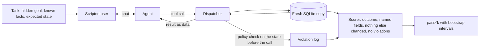

# deskbench

[](https://github.com/shreyas-tech7/deskbench/actions/workflows/ci.yml)

<!-- gen:status -->
**Status:** v0.1.0-rc1 release candidate. 45 tasks in 3 domains, all passed by the oracle. No model run yet: record mode is blocked in this build (see Results).
<!-- /gen:status -->

deskbench tests customer-support agents on the rules of three invented small businesses. A scripted customer asks for something, the agent works through real tools on a SQLite copy of the shop's data, and the score comes from the database at the end of the chat.

## The problem

A support agent that handles a refund right once can still break the refund rule on the next try. Most demos show one good chat. A team that ships an agent to a bike shop or a salon needs to know whether it follows the written policy every time, and whether it changes only the records it should.

deskbench answers both with numbers. Each of the 45 tasks has a hidden customer goal and an expected final database state. Some tasks need a polite refusal because the policy forbids the request. Some need a hand-off to a human. Every tool call passes through one dispatcher that checks the policy before the call runs, so a rule break counts even when the final state looks fine.

The headline metric is pass^k: the chance that k tries at the same task all succeed. A single pass rate cannot show that.

## How it works



1. Load a domain and copy its seeded database into memory.
2. Start the scripted user. It says its opening line and keeps every fact hidden until the agent asks for it.
3. Run the agent. Each tool call goes through the dispatcher, which runs the policy rules first and logs any break.
4. The chat ends when the agent closes the ticket or transfers it, or when the user gives up.
5. The scorer compares the final database with the task's expected state.
6. `deskbench.metrics` turns many trials into pass^1 to pass^4, violations, wrong calls, turns and tokens per task.

A trial passes only when four things hold. The ticket outcome matches (resolved, refused or transferred). Every field the task names matches. No other row changed. No policy rule fired.

### The three businesses

| Domain | Business | What customers ask for |
| --- | --- | --- |
| `bikeparts` | Spoke & Sprocket, an online bike-parts store | Order cancels, returns, exchanges, damaged parcels |
| `salon` | Clip & Curl, a hair salon | Bookings, cancels with deposits, reschedules, complaints |
| `mealkit` | Forkful, a meal-kit subscription | Plan changes, pauses, skipped boxes, credits |

Each domain has a one-page policy in `policy.md`, a seeded database in `seed.sql`, ten tools and 15 tasks. Two rules apply in every domain. The agent must verify the customer before it reads or changes their account, and it must get an explicit yes before any change.

### The scripted user

The user in `src/deskbench/user.py` is a state machine with an explicit transition table. It reveals a fact only when the agent's message asks for it, answers "yes" only to a confirmation question, nudges at most three times when the agent stalls, and stops at a turn limit. Its wording comes from `random.Random(f"{task_id}:{seed}")`, so the same seed always gives the same chat.

## Results

pass^k uses the unbiased estimator from τ-bench. For a task with n trials and c passes, pass^k = C(c, k) / C(n, k). The table averages it over tasks. Brackets hold a bootstrap 95% interval over tasks (2,000 resamples, seed 0). An interval of one value means every task scored the same, so there is no spread to show.

<!-- gen:results -->
- `oracle`: run of 2026-11-23, model none (scripted agent), seed 101 to 104, 45 tasks with 4 trials each, file `results/oracle.json`.
- `no-identity`: run of 2026-11-23, model none (scripted agent), seed 101 to 104, 45 tasks with 4 trials each, file `results/no-identity.json`.
- `no-windows`: run of 2026-11-23, model none (scripted agent), seed 101 to 104, 45 tasks with 4 trials each, file `results/no-windows.json`.
- `flaky`: run of 2026-11-23, model none (scripted agent), seed 101 to 104, 45 tasks with 4 trials each, file `results/flaky.json`. Synthetic agent, not a model.

| Agent | pass^1 | pass^2 | pass^3 | pass^4 | Violations per 100 trials | Wrong tool calls per task |
| --- | --- | --- | --- | --- | --- | --- |
| Oracle (scripted, follows policy) | 100.0% (100.0 to 100.0) | 100.0% (100.0 to 100.0) | 100.0% (100.0 to 100.0) | 100.0% (100.0 to 100.0) | 0.0 (0.0 to 0.0) | 0.00 (0.00 to 0.00) |
| Broken: skips the identity check | 13.3% (4.4 to 24.4) | 13.3% (4.4 to 24.4) | 13.3% (4.4 to 24.4) | 13.3% (4.4 to 24.4) | 135.6 (113.3 to 155.6) | 0.00 (0.00 to 0.00) |
| Broken: ignores time windows | 84.4% (73.3 to 93.3) | 84.4% (73.3 to 93.3) | 84.4% (73.3 to 93.3) | 84.4% (73.3 to 93.3) | 15.6 (6.7 to 26.7) | 0.00 (0.00 to 0.00) |
| Flaky: skips the yes on 1 in 4 changes (synthetic) | 88.9% (85.6 to 92.2) | 77.8% (71.1 to 84.4) | 66.7% (56.7 to 76.7) | 55.6% (42.2 to 68.9) | 11.1 (7.8 to 14.4) | 0.00 (0.00 to 0.00) |
<!-- /gen:results -->

<!-- gen:decay -->
The flaky agent forgets to ask for a yes on one change in four. Its pass^1 is 88.9% (85.6 to 92.2), and its pass^4 falls to 55.6% (42.2 to 68.9), because a task now passes only if all four tries do.
<!-- /gen:decay -->

The broken agents show that the scorer catches what it should. The agent that skips the identity check fails every task that touches an account. The agent that ignores time windows fails every task tagged `window`. `tests/test_broken_agents.py` checks both sets task by task.

<!-- gen:second -->
The oracle scores 100.0% (100.0 to 100.0) on pass^4, which looks too good. It is a script written against the policy, so it should. To rule out a lucky seed, it ran again on seeds 202 to 205 (file `results/oracle-seed202.json`): pass^4 100.0% (100.0 to 100.0), 0.0 violations per 100 trials.
<!-- /gen:second -->

### Dev and held-out tasks

Ten tasks per domain are for development and five are held out. The held-out tasks were set before any agent prompt was written.

<!-- gen:splits -->
| Agent | Dev pass^1 | Dev pass^4 | Held-out pass^1 | Held-out pass^4 |
| --- | --- | --- | --- | --- |
| Oracle (scripted, follows policy) | 100.0% (100.0 to 100.0) | 100.0% (100.0 to 100.0) | 100.0% (100.0 to 100.0) | 100.0% (100.0 to 100.0) |
| Broken: skips the identity check | 0.0% (0.0 to 0.0) | 0.0% (0.0 to 0.0) | 40.0% (13.3 to 66.7) | 40.0% (13.3 to 66.7) |
| Broken: ignores time windows | 80.0% (63.3 to 93.3) | 80.0% (63.3 to 93.3) | 93.3% (80.0 to 100.0) | 93.3% (80.0 to 100.0) |
| Flaky: skips the yes on 1 in 4 changes (synthetic) | 86.7% (82.5 to 90.8) | 46.7% (30.0 to 63.3) | 93.3% (86.7 to 98.3) | 73.3% (46.7 to 93.3) |
<!-- /gen:splits -->

### Record mode

<!-- gen:record -->
Record mode did not run. Checked on 2026-11-23 for model `llama-3.1-8b-instant`: no GROQ_API_KEY in the environment, so no request was sent. A probe of the provider hosts on that day gave: groq refused by the network proxy (403), openrouter refused by the network proxy (403). So no row on this page comes from a language model, and Done-means item 4 is open. The LLM agent in `src/deskbench/agents/llm.py` passes all 45 tasks against a fake local server in `tests/test_llm_agent.py`, so the loop, the tool calls, the JSON fallback, record and replay all run. `docs/HUMAN_STEPS.md` has the command to run once a free key exists.
<!-- /gen:record -->

The full report, with a breakdown by domain and a failure list that links to transcripts, is in [docs/REPORT.md](docs/REPORT.md). A static page that opens from disk is in [docs/index.html](docs/index.html).

## Cost per task

<!-- gen:cost -->
| Agent | Tokens per task | Turns per task | Wall time for the run |
| --- | --- | --- | --- |
| Oracle (scripted, follows policy) | 0 (0 to 0) | 9.2 (8.3 to 9.9) | 0.21 s |
| Broken: skips the identity check | 0 (0 to 0) | 7.5 (6.8 to 8.2) | 0.23 s |
| Broken: ignores time windows | 0 (0 to 0) | 9.5 (8.6 to 10.4) | 0.22 s |
| Flaky: skips the yes on 1 in 4 changes (synthetic) | 0 (0 to 0) | 9.0 (8.1 to 9.7) | 0.19 s |

Scripted agents send no tokens, so their cost is zero. Times are for 180 trials on one core of `Intel(R) Xeon(R) Processor @ 2.10GHz` on 2026-11-23.
<!-- /gen:cost -->

A model run needs about 45 tasks times 4 trials times 6 calls, so about 1,100 calls. Record mode saves every response in `fixtures/`, so a stopped run picks up where it left off and a replay costs nothing.

## Run it in 10 minutes

You need Python 3.11 or newer and [uv](https://docs.astral.sh/uv/).

```bash
git clone https://github.com/shreyas-tech7/deskbench.git
cd deskbench
./init.sh                      # venv, lint, link check and the offline tests
source .venv/bin/activate
deskbench show bk05            # one chat with the oracle agent
deskbench show bk05 --agent no-windows
deskbench run flaky            # 45 tasks x 4 trials, writes results/flaky.json
deskbench determinism          # same seed, byte-identical transcripts
deskbench readme               # rewrite the README tables from results/
```

To test your own agent on an OpenAI-compatible endpoint:

```bash
export OPENAI_API_KEY=...      # never commit it
deskbench llm --mode record --base-url https://your-host/v1 --model your-model --key-env OPENAI_API_KEY --limit 3
deskbench llm --mode replay --base-url https://your-host/v1 --model your-model --limit 3
```

The free presets are `--provider groq` and `--provider openrouter`, which read `GROQ_API_KEY` and `OPENROUTER_API_KEY`. If a model cannot call tools natively, the agent also accepts a plain JSON action such as `{"tool": "get_order", "args": {"order_id": 1001}}`.

To add a fourth business, follow [docs/ADD_A_DOMAIN.md](docs/ADD_A_DOMAIN.md).

## Limits

- No language model has run yet. Every number above comes from scripted agents. They prove that the tasks can be solved and that the scorer catches rule breaks. They say nothing about any model.
- The scripted user matches keywords. A model that asks for a fact in odd words may get "I'm not sure what you need" back. That is a limit of the simulator, and it may lower a model's score.
- 45 tasks is small. The intervals are wide for any agent that fails a few tasks.
- The businesses, people and data are invented. Real shops have messier policies, and real customers change their minds.
- The flaky agent is synthetic. It exists to show how pass^k falls as trials grow.
- An LLM user simulator is a stretch goal and does not exist yet.

## Glossary

- **Trial:** one chat between the agent and the scripted user on one task, from a fresh database.
- **pass^k:** the chance that k trials of the same task all pass, averaged over tasks.
- **Policy violation:** a tool call that breaks a written rule, checked on the database state before the call runs.
- **Wrong tool call:** a call to a tool that does not exist, with missing arguments, or that the tool rejects.
- **Oracle agent:** a scripted agent that follows the policy. It proves every task can be solved.
- **Held-out task:** a task kept out of development, so a tuned prompt cannot fit it.
- **Record mode:** a run against a real model that saves every response. **Replay mode** answers from those saved responses only.
- **Bootstrap 95% interval:** the range that holds the middle 95% of means when tasks are resampled with replacement.

## Related work

[τ-bench](https://arxiv.org/abs/2406.12045) from Sierra set this design: a simulated user, domain tools and a written policy, scored by the database at the end of the chat. It introduced pass^k. [τ²-bench](https://github.com/sierra-research/tau2-bench) adds a telecom domain. deskbench differs in three ways. It uses small-business policies. Its scripted user is deterministic, so every replay is free and a test can pin a transcript byte for byte. And it checks the policy on every tool call, so a rule break fails a trial even when the end state looks right. Every task and policy here was written from scratch.

## How this was built

AI agents wrote most of this code under Shreyas's direction. The full build brief is in [docs/build/BUILD_PROMPT.md](docs/build/BUILD_PROMPT.md). The choices and their reasons are in [DECISIONS.md](DECISIONS.md).

Human checks, not done yet:

- Shreyas has not read the code or the tasks.
- Shreyas has not run a model in record mode.
- Shreyas has not checked that each policy reads like a real small business.

## License

MIT. See [LICENSE](LICENSE).
